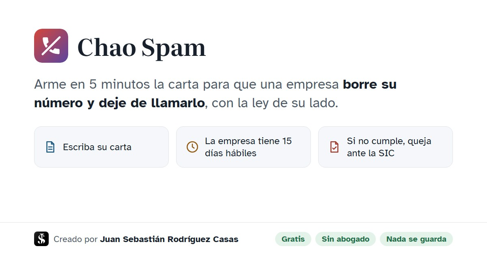

<p align="center">
  
</p>

<h1 align="center">Chao Spam</h1>

<p align="center">
  <b>Pida que borren su número y dejen de llamarlo, con la ley de su lado.</b><br>
  Servicio gratuito · Sin abogado · 5 minutos · Nada se guarda<br>
  Creado por <a href="https://sebastian-09781.blogspot.com/"><b>Juan Sebastián Rodríguez Casas</b></a>
</p>

<p align="center">
  👉 <a href="https://sebastian09781.github.io/peticion-antispam/"><b>sebastian09781.github.io/peticion-antispam</b></a>
</p>

<p align="center">
  
</p>

---

## ¿Qué resuelve?

En Colombia las empresas compran, comparten o heredan bases de datos, y a muchas personas las llaman a toda hora para venderles créditos, planes o seguros que nunca pidieron. La ley permite exigir que borren esos datos, pero casi nadie sabe qué norma invocar, cómo redactar la carta, a quién enviarla ni qué hacer si no responden.

**Chao Spam** resuelve los cuatro pasos desde el celular, en lenguaje sencillo.

## ¿Cómo funciona?

Sigue el camino que recomienda la propia Superintendencia de Industria y Comercio (SIC) en su guía oficial: primero se reclama ante la empresa y, si no cumple, se presenta la queja ante la SIC.

Un paso por pantalla. **El botón grande de abajo siempre es la siguiente acción real**, así nadie se pierde:

**A. Escribir mi carta a la empresa**

| Pantalla | Botón de abajo |
|---|---|
| 1. Sus derechos: pueden borrarlo, 15 días hábiles, horarios permitidos, multas | Siguiente → |
| 2. Sus datos: nombre, documento, municipio (lista oficial del DANE) y correo | Siguiente → |
| 3. ¿Cómo lo molestan?: llamadas, SMS, WhatsApp o correo, a qué número y si es cliente | Siguiente → |
| 4. La empresa: buscador que llena la razón social y el correo de datos personales | Siguiente → |
| 5. Foto de su cédula: cámara con marco guía del tamaño de la cédula, recorte automático al marco, botón para girar; la marca de agua ("solo para hábeas data a [empresa] · fecha") se pone en el propio celular | **Ver mi carta** |
| 6. Léala antes de enviarla: la carta con formato, editable | **Enviar por correo** |
| 7. Agéndelo: la fecha límite, ya sin contar festivos | **Agregar al calendario** |
| ¡Gracias! Compartir, bloquear el número en la CRC, escribir a otra empresa | **Terminar** |

**B. Ya envié mi carta y no me respondieron**

| Pantalla | Botón de abajo |
|---|---|
| Sus datos · ¿Cómo lo molestan? · La empresa | Siguiente → |
| Cuéntenos qué pasó: fecha de envío, qué pasó y si ya venció el plazo | Siguiente → |
| Foto de su cédula, con marca de agua para la queja ante la SIC | **Ver mi queja** |
| Léala antes de enviarla: dirigida a `contactenos@sic.gov.co` con el asunto que exige la SIC | **Enviar a la SIC** |
| ¡Gracias! | **Terminar** |

## ⚖️ Sustento jurídico

La carta pide la **supresión** de los datos, la **revocatoria** de la autorización, **copia de la autorización** que la empresa dice tener y que la orden **se extienda a los encargados**: *call centers*, agencias y aliados que llaman a nombre de la empresa. Si la empresa que recibe la carta no es la responsable, debe **trasladarla en 2 días hábiles**. Cada dato legal tiene en la página un botón **⚖ Normas** que muestra el texto o la captura oficial.

| Qué se afirma | Fuente oficial |
|---|---|
| Primero se reclama a la empresa y luego a la SIC; correo y asunto de la queja | [SIC, Preguntas frecuentes de Protección de Datos, pregunta 9](https://www.sic.gov.co/sites/default/files/files/2022/Preguntas%20frecuentes%20Delegatura%20Datos%20Personales%202022.pdf) |
| Requisito de procedibilidad (15 días hábiles sin respuesta o respuesta inadecuada) | [SIC, Consultas y reclamos](https://www.sic.gov.co/consultas-y-reclamos-pdp) |
| Plazo de 15 días hábiles más 8 de prórroga; traslado en 2 días; deberes del responsable frente a sus encargados; multas hasta 2.000 SMMLV | [Ley 1581 de 2012, arts. 3, 15, 16, 17 y 23](https://normograma.mintic.gov.co/mintic/compilacion/docs/ley_1581_2012.htm) |
| Horarios permitidos para contactos comerciales | [Ley 2300 de 2023, art. 3 y art. 5, par. 3](https://normograma.mintic.gov.co/mintic/compilacion/docs/ley_2300_2023.htm) |
| Correo de denuncias y Registro de Números Excluidos | [SIC, Circular Externa 001 de 2024](https://normograma.mintic.gov.co/mintic/compilacion/docs/circular_superindustria_0001_2024.htm) |
| La autorización debe ser previa, expresa e informada; el silencio no es autorización | [Corte Constitucional, Sentencia C-748 de 2011](https://www.corteconstitucional.gov.co/relatoria/2011/C-748-11.htm) |
| Las llamadas y los mensajes comerciales sin autorización vulneran el hábeas data | [SIC, Resolución 78138 de 2025](https://sedeelectronica.sic.gov.co/sites/default/files/normativa/2025078138RE0000000001.pdf) |

Fuentes revisadas el 7 de noviembre de 2026. Las citas se comprobaron textualmente en los documentos oficiales.

## 🔒 Privacidad: código abierto y auditable

**Nada se guarda.** Es una sola página HTML, sin servidor propio, base de datos, cuentas, cookies ni analítica. La carta se arma en el navegador y se borra al cerrar la pestaña. El correo sale desde el correo de la propia persona.

| Servicio externo | Para qué | Qué recibe |
|---|---|---|
| [datos.gov.co, RUES](https://www.datos.gov.co/d/c82u-588k) | Buscar la empresa | Solo el nombre de la empresa que se escribe |
| [datos.gov.co, DIVIPOLA (DANE)](https://www.datos.gov.co/d/gdxc-w37w) | Lista oficial de los 1.122 municipios | Nada de la persona |
| [Nager.Date](https://date.nager.at) | Festivos de Colombia para contar días hábiles | Solo el año |
| Google Fonts · GitHub Pages | Tipografías · alojamiento | Nada de la persona |

## ♿ Accesibilidad

- **Guía por voz:** una voz recorre cada pantalla y explica cada caso. Solo lee instrucciones, nunca los datos de la persona.
- **Botón "Aa":** letra más grande (hasta 150 %), alto contraste y modo sin animaciones.
- Campos con validación y mensajes claros (por ejemplo, el nombre solo admite letras y la cédula solo números), navegación con teclado y respeto por la preferencia de "reducir movimiento" del teléfono.

## 🏢 Directorio de empresas

[`empresas.js`](empresas.js) reúne 23 de las empresas que más llaman, según las quejas ante la CRC y las sanciones de la SIC de 2023 a 2025. Para cada una registra su razón social, su NIT y el correo de datos personales, **verificado en su política oficial** (con enlace). Si la empresa no publica un correo, lo dice. Para cualquier otra empresa, el buscador consulta el RUES.

¿Falta una empresa o cambió un correo? Abra un *issue* o un *pull request* con el enlace a la política oficial.

## 📁 Estructura

```
index.html            La aplicación completa (HTML, CSS y JavaScript sin dependencias)
empresas.js           Directorio verificado de empresas
manifest.webmanifest  Datos para instalarla como aplicación en el celular
sitemap.xml           Mapa del sitio para buscadores
favicon.ico
img/                  Logo, íconos, imagen para compartir y capturas oficiales de la SIC
```

## Aviso

Chao Spam es un servicio gratuito que facilita el trámite. No es asesoría jurídica ni tiene relación con la SIC ni con las empresas mencionadas. Antes de enviar, verifique que el texto se ajuste a su caso.

## Autor y licencia

&nbsp;Creado por [Juan Sebastián Rodríguez Casas](https://sebastian-09781.blogspot.com/). Licencia [MIT](LICENSE). Los íconos del teléfono del logo son de Material Icons (Apache 2.0).
